# Ironfield

A 2.5D (2D sprites in a 3D world) medieval battle game in C# + MonoGame (DesktopGL), inspired by the
"lead your army in person" genre. This is an original setting: no names, assets or factions from other games.

You fight in person as a soldier while you command your army as a general, and between battles you lead a mercenary company
through a war of seven realms on a campaign map: sieges, fiefs, prisoners, contracts, seasons and the rest of `docs/archive/ROADMAP.md`.

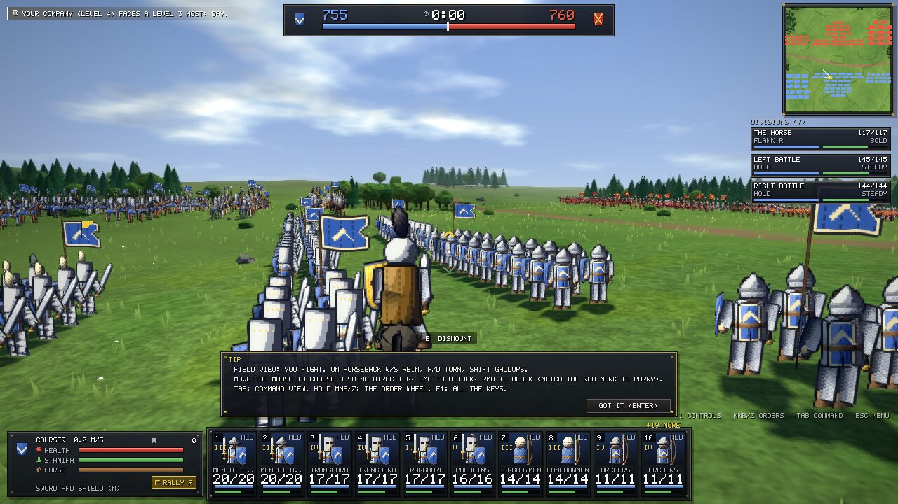

**At a glance (November 2026)**
- **Battles of up to 3,000 men** on the field at once (Battle size setting), more waiting as reinforcements. You fight in the
  front rank (directional blows, parries, couched lances) and command from above in slowed time, or hand wings to sergeants'
  **divisions** that follow a goal.
- **A war of seven realms** on a map of 115 provinces, each realm with its own heraldry, temper and four lines of troops:
  188 troops across seven cultures and common, plus 13 creatures (goblins, wolves, trolls, the dead).
- **A company that is your legacy:** named men on the roll, the fallen remembered, banner honours won and lost, a career from
  hired sword to king, and a captain with gear, skills, wounds and a name.
- **Ground that matters:** ridges, woods, fens, river lines, villages and hedgerows, with sight, cover, ambushes and an enemy
  that reads the field.
- **It moves:** animated men and horses, blows with weight, trampled earth, weather and light by the hour, fades and battle
  names (see "Design: motion and feel").
- **No art files:** every sprite, mesh, sound and tune is generated in code.

### Screenshots

Taken in the game at 1280x720 with `IRONFIELD_SHOTS` and `IRONFIELD_CAMPAIGN_SHOTS` (software rendering, High quality).

| | |
|---|---|
| 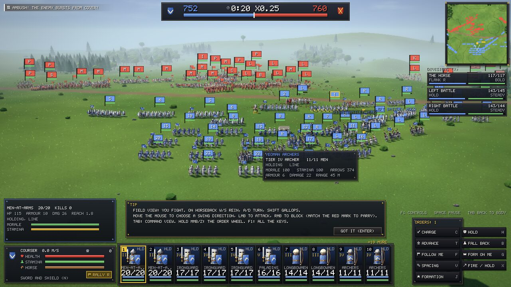 | 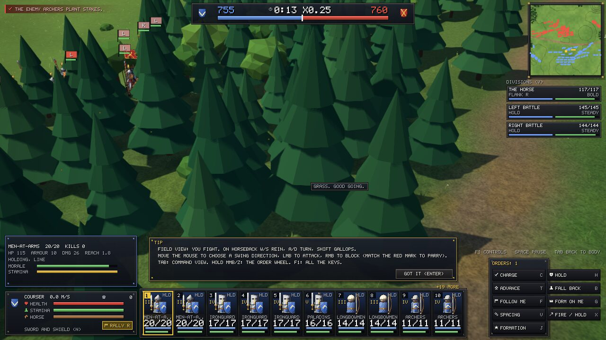 |
| **Command view:** about 750 men a side, divisions on the right, an ambush in the feed. | **Woods:** low-poly pines; a wood hides men and halves a horse's pace. |
| 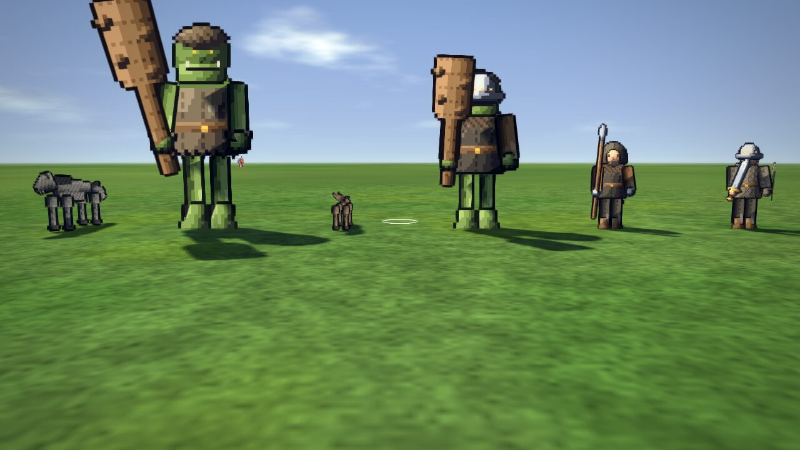 | 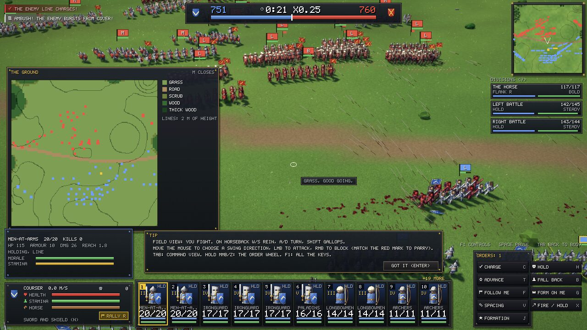 |
| **Creatures:** trolls, goblins and wolves fight by their own rules. | **Ground map (M):** every kind of ground in its colour, with height lines. |
| 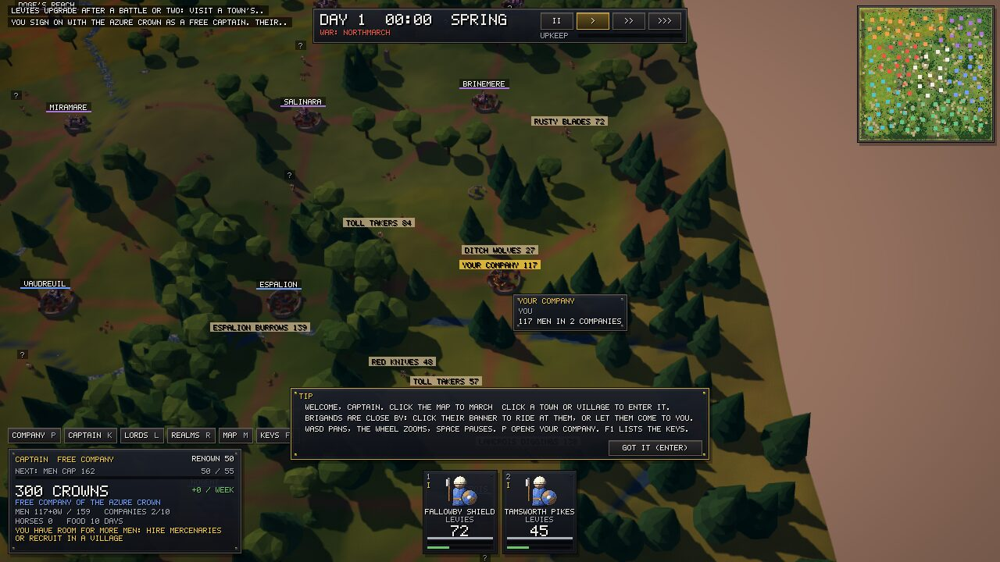 | 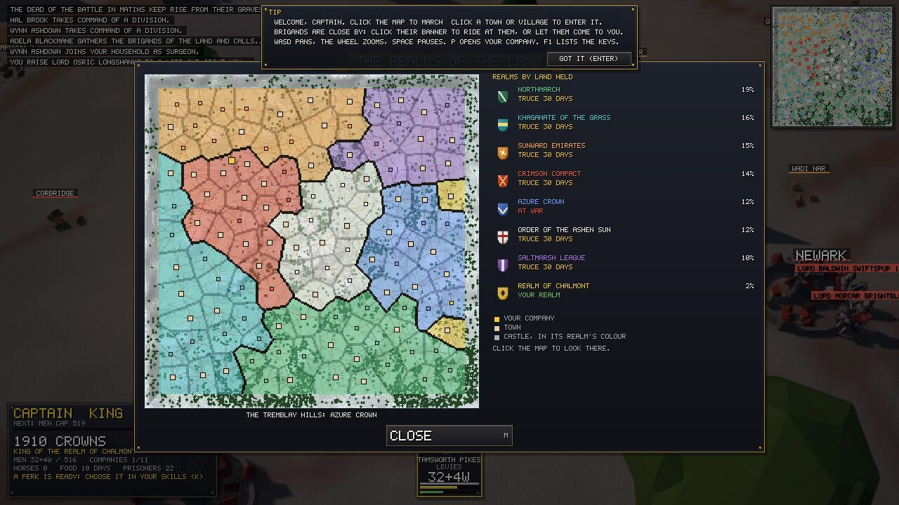 |
| **Campaign map:** towns, brigands and your company. | **Realm map (M):** seven realms and their borders. |
| 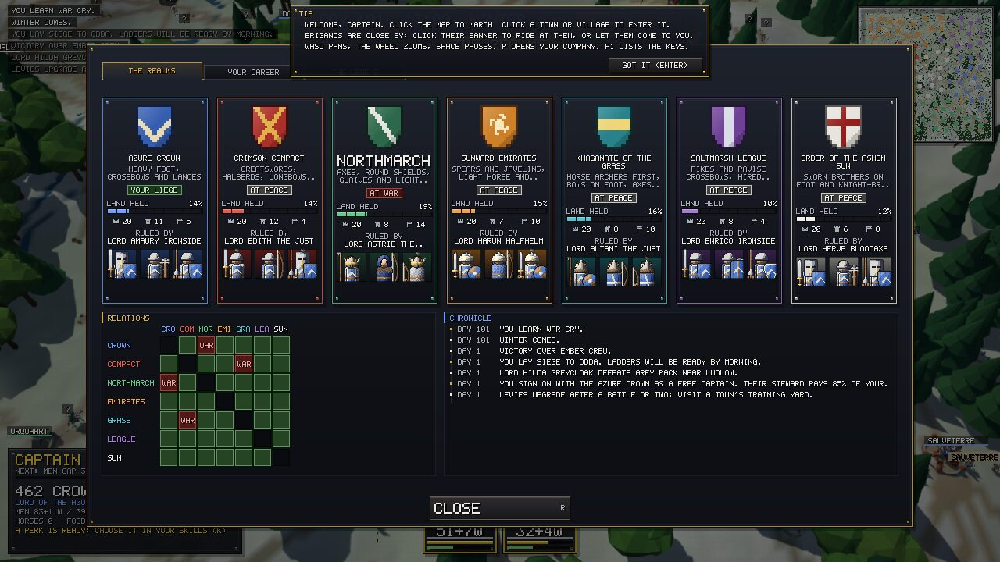 | 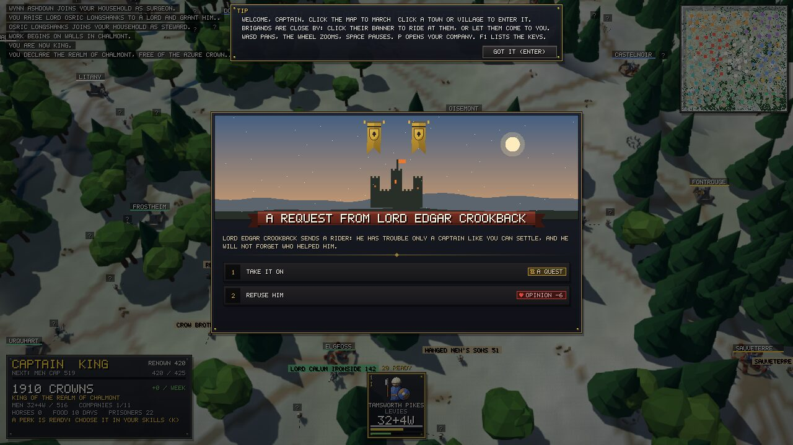 |
| **Realms (R):** heraldry, troops and relations. | **Events:** an illustrated scene with choices. |
| 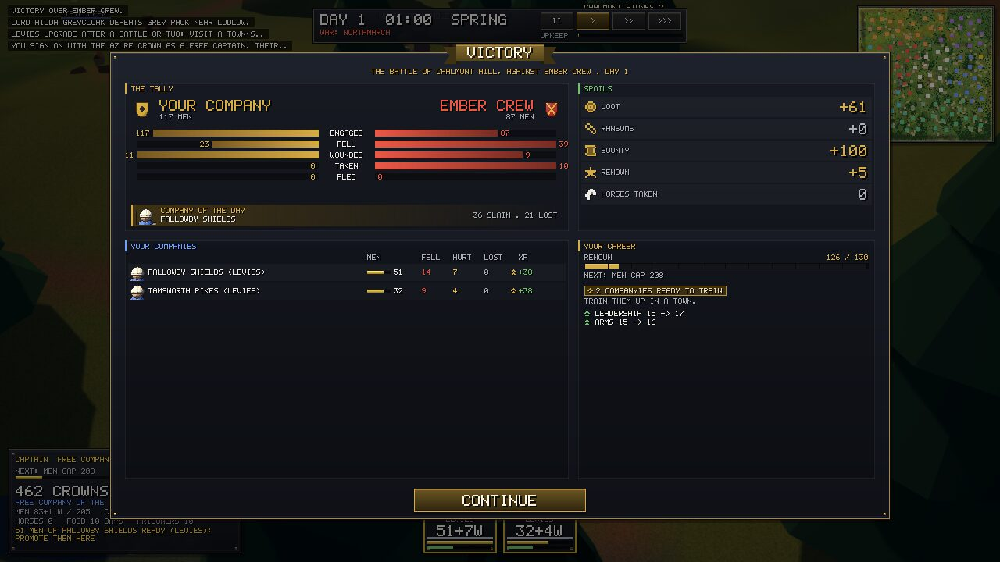 | 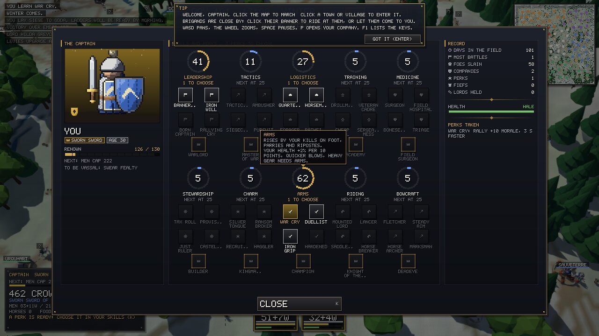 |
| **After the battle:** the tally, spoils, your companies and skills that rose. | **Captain sheet (K):** ten skills, their perks and your record. |
| 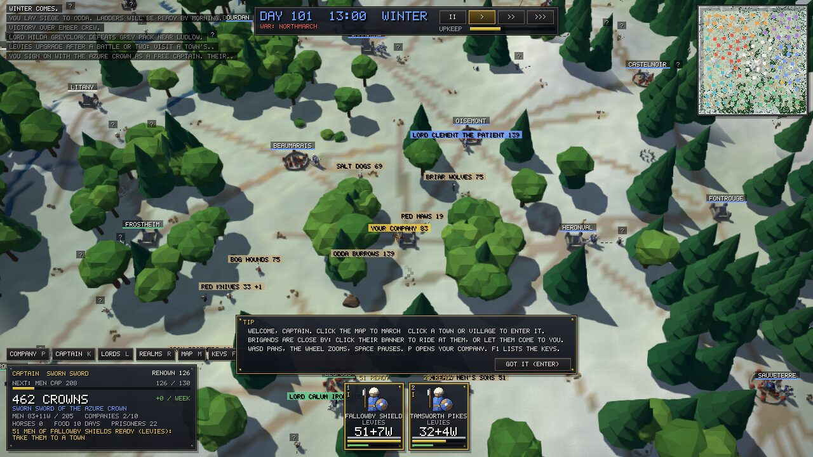 | 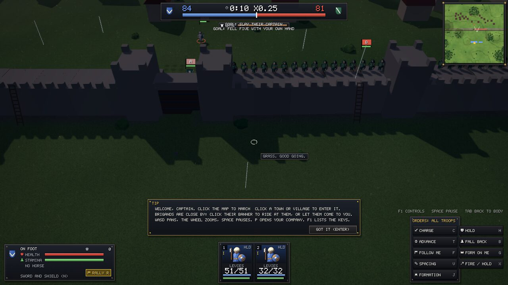 |
| **Winter:** snow on the map; the march slows and rations double. | **Sieges:** an assault on a town wall; climb at the ladders or batter the gate. |

## Build / run / test

```sh
dotnet build
dotnet run                 # play
dotnet run -- --selftest   # headless: mechanics, battles, sieges, campaigns, saves and replays
dotnet run -- --selftest SiegeBattle   # one test by name
dotnet run -- --balance 4  # telemetry: N headless campaigns (and a stand-in captain's career pacing) and battles -> balance/*.csv
dotnet run -- --replay     # play back your last battle (replays/last-battle.json) and check it ends the same way
dotnet run -- --gpu-report # draw a battle at each quality; writes gpu-report.txt (driver, shaders, fps)
dotnet run -c Release -- --bench 1500  # headless N-a-side battle: ms per tick for each stage of the simulation
```

You need .NET SDK 10 (`net10.0`). On Ubuntu 24.04 `apt-get install dotnet-sdk-10.0` works (no Microsoft feed needed).
The game needs no art files: sprites, terrain and the font are all generated in code. Troops come from `Data/troops.json`.
**Design language:** see [`docs/DESIGN.md`](docs/DESIGN.md) (art direction, unit painting rules, heraldry, tiers, UI tokens).
**Roadmap:** see [`docs/archive/ROADMAP.md`](docs/archive/ROADMAP.md) (what comes next, in what order, and why).
**Campaign:** see [`docs/CAMPAIGN.md`](docs/CAMPAIGN.md) (map, companies, XP and upgrades, economy, AI, battle hand-off; "As built" at the end).
**The player fantasy:** see [`docs/archive/LEGACY.md`](docs/archive/LEGACY.md) (your company is your legacy). **Other plans, all built:**
[`COMBAT_OVERHAUL`](docs/archive/COMBAT_OVERHAUL.md), [`CREATURES`](docs/archive/CREATURES.md), [`SIDE_CONTENT`](docs/archive/SIDE_CONTENT.md),
[`PROGRESSION`](docs/archive/PROGRESSION.md), [`WORLD`](docs/archive/WORLD.md), [`TERRAIN`](docs/archive/TERRAIN.md), [`POLISH`](docs/archive/POLISH.md),
[`VISUALS`](docs/archive/VISUALS.md). **Developers:** [`docs/DEVELOPING.md`](docs/DEVELOPING.md) and [`CLAUDE.md`](CLAUDE.md).

The game opens on a **title screen**: New Campaign, Continue (latest save), Quick Battle (one random battle), Quit.
To inspect the sprite atlas, run `IRONFIELD_DUMP_ATLAS=/path/atlas.png dotnet run`.
To render a few staged camera shots as PNGs and quit (works headless with `xvfb-run -a dotnet run`), set `IRONFIELD_SHOTS=/some/dir`
(`IRONFIELD_CAMPAIGN_SHOTS` does the same for the campaign screens). `IRONFIELD_WEATHER=hour,rain,fog` and `IRONFIELD_GROUND=river` set a quick battle's
weather and ground; `IRONFIELD_MEN=n` sets its men a side (default: half the Battle size setting).
`dotnet run -- --write-controls` writes `controls.json` with the default bindings.
Graphics quality: **F2** cycles High (shaders, sun shadows, post) / Medium (no shadows) / Low (fixed-function); `IRONFIELD_QUALITY=Low` picks one at start.
UI lab: **F3** on the title screen opens a gallery of interface concepts (left/right to page, Esc back).
Shaders are plain GLSL in `Shaders/` and need **no shader compiler** (no MGFXC, no Wine): see "Shaders" below.

## The campaign

**The heart of it:** you lead a free company in person. Every man you lose was someone you knew, and every honour on the
banner is one you earned (`docs/archive/LEGACY.md`).

You are a free captain sworn to the Azure Crown in the west. It is at war with the Northmarch clans of the cold north, its long
border; the Crimson Compact in the east fights the Khaganate of the Grass, horse archers from the eastern steppe. The Sunward
Emirates hold the dry south, the Saltmarsh League the fens and canals of the south-west, and the knight-brothers of the Order of the
Ashen Sun the highlands in the middle. Brigands, goblins and worse roam between them all. The land is about 930 km across, with
mountain ridges you cross by road at the passes.
- **Map:** click to march, click a town or village to enter it, and click a party to chase it. P opens the party screen, Space pauses,
  1-3 set the speed (x1, x3, x8), F follows you, F5 saves, F9 loads, and Esc opens the menu. The camera works as in command view (WASD, Q/E, wheel,
  middle-drag), and the overview (top right) jumps the camera. Hover anything for details.
- **Big armies.** Campaign armies are three times the old size (`ArmyScale` in `Data/campaign.json`): you start with about 120 men
  and can lead several hundred late on; lords field 100-200, and companies hold up to 72 men. Prices per man are a third of
  the troop price, so the economy works out as before. **Battle size** (Settings, GAME tab: 400 / 800 / 1,500 / 3,000) is how many
  men stand on the field at once; the rest wait as reinforcements. The field grows with the armies.
- **Divisions (V, or DIVISIONS on the party screen):** put companies under a companion or a company's sergeant. A division fights
  by a **goal** (hold, attack, flank left or right, reserve, screen, harass, guard) rather than your orders, in the leader's temper
  (bold, steady, cautious) and with his command skill, which grows with the battles he leads. Companies in no division are your
  retinue and obey you at once. At most 6 divisions; a division whose leader falls or leaves breaks up. Skilled leaders also help
  a little when you auto-resolve. Big enemy armies split into divisions too (a horse wing and two foot battles).
- **Companies persist.** A company is a banner of one role (foot, spears, bows or horse) holding **stacks** of troops, each with its own
  XP pool. Men are **promoted one at a time** along `troops.json` in a town's training yard: click a stack in the party screen and promote
  1, 5 or every ready man into any branch. A man promoted out of the company's role joins a company of his new role, or founds one.
  A mixed company fights as one squad. Companies keep an origin, a banner, a ledger of their last fights and up to three **honours**
  (Unbroken, Horse-breakers, Old Hands, Stormers, Bloodied) that change how they fight. Saves from before this (version 3 and older) are refused.
- **The roll:** each of your companies keeps up to six **named men** (ROLL on its card in the party screen). A new company names
  its first man, and men earn names in battle (first over a wall, a horseman brought down, standing when half the company fell).
  A named man is one of the men of his stack: he shares its losses (a little less often killed), is promoted before the others, and goes
  where his men go. In a fought battle he is a real man in the front rank (a gold mark over him near you) and earns his own deeds.
  Those lost are kept for ever under THE FALLEN, named first in the battle report, and each costs his company cohesion. When a
  company needs a sergeant, its senior named man rises to the post, and a sergeant of 15 battles joins your household.
- **The legend:** great battles are named and sewn on the company's banner as honours; a rout can lose one to the enemy until
  you win it back. Fame from your companies raises pay, recruits and the regard of lords. In battle, stand over a fallen named
  man to pull him out alive. THE LEGEND (R) lets you retire in glory or hand the company to a companion and play on.
- **Cultures:** every troop is of one of the seven cultures or common (`Data/troops.json`), and each realm has a culture (`Data/factions.json`).
  A village raises its own culture's men whoever holds it (clansmen in the north, levies in the south), and they form companies of their own
  people. Men train into common troops or their own culture's lines only, and a culture's elite lines (tier V and up) need one of its towns
  in your realm. Foreign mercenaries are the other way to field another culture's elites.
- **Lords and companions:** every lord is a character with traits (Honourable, Cruel, Cautious, Reckless, Greedy, ...) that drive what he
  does, and an opinion of you with the memories behind it ("you beat me in the field", "you set me free without ransom"); opinions fade
  with time. A lord who thinks ill of you keeps his villages' recruits from you. A lord can fall in battle and his heir takes up his banner
  and his grudges. Sergeants who live through 15 battles, and wanderers found in town taverns, join your household as **companions**
  (quartermaster, surgeon, scout, drillmaster or steward) and lead a company into battle as a hero. L opens the lords and companions screen.
- **Towns:** train, hire mercenaries, buy horses and food, kit yourself out at the armourer (MARKET tab: weapons from spear to crossbow, shields, armour, helms and horses; stock changes weekly, heavy pieces need the Arms skill, the best need a rank; worn gear can be swapped, spare gear sold back at 40%), rest to heal, sell prisoners
  and ransom lords, sign or end contracts, and take work from the steward's board (hunt a lord, clear brigands, guard a village, scout a town,
  take a castle). **Villages:** recruit (levies, or clansmen in the north), buy or forage food. **Castles:** rest, prisoners and contracts.
- **Sieges:** ride to an enemy town or castle and besiege it. After a night your men have ladders and a ram; assault the walls (an on-foot
  battle: climb at the ladders, batter the gate, defenders on the walkway) or wait while the garrison starves. A seat you capture as a sworn
  vassal becomes your **fief** (your first at once, later ones by the council's vote): weekly income, and a garrison you can strengthen
  with your own companies. Before you swear fealty the realm keeps it and pays you a captor's purse. Lords besiege and retake seats too.
- **Fiefs live:** each has **prosperity** (it scales income and recruits; raids and sieges hurt it) and **unrest** (foreign rule,
  high taxes, sieges and raids raise it; a garrison, a chapel and low taxes calm it). At 70 unrest rebels take the field; at 100 the place
  goes over to the realm of its own people. In your fief's FIEF tab set **taxes** and raise **buildings**: training yard, barracks (a
  culture's elite tiers need one), walls, market, granary, stables, chapel and watchtower. AI realms build too. As a lord with two fiefs
  you can give one to a companion and make him your **vassal**, with standing orders (defend my lands, follow me, join the host); lords who
  hate their liege may defect to a ruler they like.
- **War and peace:** wars wear realms down (losses, lost seats, time). A weary realm sues for peace on the winner's terms: a plain
  truce, gold over four weeks, a seat handed over, or **tribute** (a quarter of its income, and it fights its overlord's wars). Realms at
  rest pick new wars. The marshal **musters hosts** of the lords who respect him, and as a vassal you are **summoned**: come within four
  days to win his favour. As king you declare war, offer peace on terms (only as far as you are ahead), and ally against a shared enemy;
  your tributaries' land counts toward victory.
- **Events and quests:** every few days something happens that depends on your world: a petition from a restless fief, famine,
  a fair, a lord asking a favour (a quest that wins his friendship; refusing costs it), a plot against your liege, a feast for your
  veterans, a hard winter, a tournament. A big brigand band can crown a **brigand king** who burns villages, and a bad revolt can raise
  a **pretender** who will take the town if you do not beat him. Events are data in `Data/events.json`.
- **Between the towns:** ruins, shrines, standing stones, old battlefields, mines, hermits, watchtowers, springs and mills dot
  the map; ride to one to search, pray, rest or ask. Merchant caravans and pilgrims travel the roads: buy from them, ask their
  news, or rob them (their realm will not forget). Village elders ask for small jobs anyone may take (wolves, goblins, a
  stolen daughter, grain, militia drill); towns add caravan escorts and ransoms; lords may send you after a lost sword.
- **Sight:** you make out who a party is only within a day's sight of your company or your fiefs; further off you see
  banners, not names. A Scout companion sees a quarter further; the top of a watchtower doubles it for two days.
- **Your record:** your deeds stay in the realm tab's chronicle, and when the war ends a summary tells what you did.
  A weary enemy may send an envoy to sue a king for peace.
- **Town life:** the tavern has a wanderer now and then and rumours of real things nearby (ride there from the list).
  A tournament is a short fight in the lists with your captain and six of your best men: blunt weapons, no deaths, a purse.
- **Prisoners** follow you (they slow you and eat): sell, recruit or free them. Lords you beat may be captured and ransomed.
- **Officers:** sergeants with traits (Stubborn, Steady, Drillmaster, Hothead, Sharpshooter, Surgeon, Veteran) that show in battle; they can fall.
- **Seasons and food:** winter slows the march, slows healing and doubles rations; starving men lose cohesion and desert. Your liege's towns feed you.
- **Seven realms:** wars and truces are per pair, and realms go to war with their neighbours; two realms fighting the same
  stronger realm tend to ally, and a realm that holds too much (30% of the seats with seven realms) unites its neighbours against
  it. Each realm has a temper: the Khaganate and the Northmarch are quick to war, the Saltmarsh League and the Sunward Emirates
  keep full garrisons and take terms readily, the Khaganate dislikes sieges, and the Order of the Ashen Sun hunts goblins, beasts
  and the dead before men. A new campaign asks which realm your company starts in. Each realm has its own
  heraldry and its own troops in all four lines, in its own kit: turbans, lamellar and camel riders in the south, fur-brimmed helms and
  long deel coats on the steppe, brigandines and tall pavises in the Saltmarsh League, white surcoats in the Order. The four younger
  realms' men may also train as their kin's troops (a Sunward man may become a Crimson greatsword, never an Azure man-at-arms).
- **Encounters:** attack (the battle opens in a **deployment phase**: arrange your lines in your third of the field, then Space or START), auto-resolve,
  retreat (a rearguard pays), or pay brigands off. Esc in a campaign battle lets you **withdraw**.
- **Duels:** meeting a lord, **CHALLENGE** him to single combat between the armies (on foot, the two of you, a fall is a yield). A cautious lord refuses, and one whose army is half again as strong as yours sees no need unless he is reckless or honourable. Win: +10 renown and his men start the battle 15 morale down. Lose: you are wounded and lead the battle from the rear. One duel an encounter.
- **Results:** the fallen split into killed and wounded (heavier armour survives more often). Then come XP, loot, ransom, bounty, renown and captured horses, and sometimes a piece of the beaten leader's gear to take (sure if you cut down a lord; a tournament win may give a prize too).
  If you fall you are wounded, and command from the rear for a few days; if your army also loses, you are captured and ransomed.
- **The world runs without you.** Lords recruit, refit, upgrade (same rules and prices), patrol, hunt, flee and muster hosts, and
  march for the front rather than idling at home, so realms fight each other whether or not you are there. Brigands are very
  common — around 190 bands on the enlarged map, spawning in several a day — and grow with the campaign: a late band is a real
  fight, not loot. Villages get threatened, the war score moves,
  the losing side sues for a 30-day truce, and the war resumes when it ends. Upkeep is weekly, a contract pays 85% of it, and unpaid men desert.
- **A career, from hired sword to king.** Your **rank** rises: Free Company → Sworn Sword (a month in one realm's service; its recruits
  cost you half, and your liege pays a weekly retainer) → Vassal (swear fealty at 120 renown when your liege trusts you; hold land, vote in council) → Lord (two fiefs and 350
  renown; propose wars, declare independence) → Marshal (500 renown to stand, then elected by the council; name the realm's objective) → King (declare
  independence from a town you hold: your fiefs become a new realm at war with your old liege, and lords who like you more than him follow).
  Every realm's **council** sits each fortnight to grant captured seats, elect a marshal and vote on war. A king declares war and offers
  peace himself. **You win** when your realm holds 60% of the provinces while you are its king or marshal (play on after); a king whose
  realm loses its last seat has lost. R opens the realm screen: every realm, their relations and the chronicle, with your career and your acts on its second tab. M opens the realm map: every province in its
  realm's colour, the borders between realms, the towns and you, with the realms listed by the land they hold; click it to look there.
- **Progression is spelled out.** The captain panel shows your **rank** and one clear **next step**
  — promote your ready men, choose a perk, see a steward for work, buy food — and arriving in a town opens the tab that step
  names. You can field up to **10 companies** right away; **Renown** raises your total troop count (men limit); a bar under the captain
  panel shows the next rise and how far off it is, and the results screen repeats it after every battle.
- **Captain skills:** ten skills (Leadership, Tactics, Logistics, Training, Medicine, Stewardship, Charm, Arms, Riding, Bowcraft) rise by doing what
  they name: commanding, winning against the odds, marching, promoting men, healing them, ruling fiefs, winning goodwill and ransoms,
  your own kills and parries on foot, your kills and lance hits from the saddle, and your arrows. Every 25 points opens a perk on that branch, in tiers: tier I at 25, II at 50, III at 75, and at 100 a crowned capstone that needs two other perks of the branch (50 in all: Bannerman, Iron Will, Tactician, Siegecraft,
  Quartermaster, Drillmaster, Cheap Steel, Surgeon, Tax Roll, Silver Tongue, Ransom Broker, War Cry, Duellist, Lancer, Marksman, ... and the capstones Warlord, Master of War, Champion, Deadeye ...). Heavy
  gear needs Arms, great horses Riding, the war bow Bowcraft. K opens the skill tree; in a friendly town you can forget a taken perk (click it twice) for 150 crowns, 150 more each time. The battle report lists each skill that rose. A fall in battle may leave a lasting wound (a scar, a bad knee, a broken hand, a lost eye); Medicine and a surgeon make it rarer, and resting at a healing spring mends all but scars. What you do earns you a name: Lionheart, Steadfast, Merciful, Ruthless or Coward. Names come and go with your record, lords like or dislike them by their own nature, and each brings its own events. A year is 120 days; past 45 your arm weakens each season but you learn to lead faster. A new campaign opens the **character creator** (six steps beside your captain, who acts out each step: stands for the homeland, marches out, lives the past, shows how they fight, turns their face to you and raises the blade for the oath, and cheers each choice; and a ledger of what each choice gives): your homeland (the realm you start in), your birth (Born in the Hall, to the Plough, in the Market, in the Baggage Train, Raised in the Cloister), your past (Sellsword, Hedge Knight, Disinherited Heir, Deserter, Poacher, Reformed Outlaw, Barber-Surgeon, Drill Sergeant; each with a free perk, skills, men or gear, and a story event of its own after the first fortnight; a Deserter flies no realm's colours), how you fight (sword and shield, the lance or the bow: the skill at 20 and the kit to match), your face (skin, hair, beard: it is yours in every battle) and names for you and your company, then the oath. ROLL THE DICE draws it all at random. Origins live in `Data/origins.json`. Each rank gives you something: a free perk as a Sworn Sword; from Vassal a household guard in your colours (15 men of tier III; 25 of tier IV as a Lord; mounted as Marshal; 40 tier V knights as King) that takes no slot, never deserts, refills itself and follows you in battle; a Lord's banner reaches further; a King's first rally in a battle, the King's Charge, calls every broken company back. A free company with 400 renown that storms a town under contract may keep it and crown itself, at war with its paymaster. Past 300 renown people give you a title (the Bold, the Lionheart, Goblin-Bane...). Each battle from the campaign sets you two personal goals (slay their captain, fell five with your own hand, break their horse, no company routs, a quick win), shown under the top bar; each met is worth renown and skill. A man of yours carries your banner: if he falls, your men lose heart and your aura is gone until you or one of them picks it up. The first time you fall in a battle you are down, not out: rally (R) within four seconds to fight on at a quarter of your health. Balance numbers live in `Data/campaign.json`; names in `Data/names.json`.

## Controls

Press **F1** in game for the full list. Every key below is a default: rebind in `controls.json`
(`dotnet run -- --write-controls` writes a template with every action, plus `MouseSensitivity` and `InvertMouseY`).
Keys are MonoGame `Keys` names (`W`, `LeftShift`, `F1`...) or `LMB`/`RMB`/`MMB`/`MB4`/`MB5`, `SHIFT`, `CTRL`, `ALT`, `ESC`, digits.

**Field view** (you fight; third-person camera, mouse wheel zooms it). You start **on horseback**.
- Mounted: W/S rein (speed up / slow, back up), A/D turn the horse, Shift gallop, Q couch the lance (needs speed), E dismount (when nearly still).
  The mouse looks around freely: you strike where you look, not where the horse points.
- On foot: WASD move, Shift sprint, E mount a loose horse within reach (yours, a fallen rider's, or the enemy's). Prompts appear on screen.
- **Attack direction** comes from the way the mouse last moved: up = overhead, down = thrust, left/right = side cuts.
  The gold chevron at the crosshair shows it. LMB hold+release attacks (longer hold hits harder).
- RMB block (front only). A shield stops any direction at a stamina cost; blocking **in the direction the blow comes from**
  (red chevron) is a **parry**: free, and it staggers the attacker. RMB while winding up cancels the swing (feint).
- R rally. **Hold MMB (or Z) for the order wheel**: move the mouse toward an order, release to give it.

**Command view** (Tab; time x0.25, Space pauses):
- LMB select a squad, drag a box to select several (Shift adds). Click a unit card to select it, double-click to jump the camera to it.
- RMB click moves (keeps the current width), RMB drag draws the formation line (it faces the enemy) with a preview of every man's spot,
  RMB on an enemy squad attacks it (red line; hovered enemies are ringed).
- WASD or the screen edges pan, Q/E or middle-drag orbit (middle-drag also tilts), wheel zoom, click the minimap to jump there.
- The order buttons (bottom right) give the same orders as the hotkeys.

**Orders (both views):** 1-9 toggle a squad, 0 or ~ selects all (with nothing selected, orders go to every squad).
C charge, F follow me, G form a line on me, H hold position, T advance 15 m, B fall back 20 m, V loose/tight spacing,
**J formation** (line, shield wall, square, wedge, loose), X archers fire at will / hold fire. Allied lords' companies follow their own AI general.

**Divisions (both views):** division cards sit top left; click one (or press **Y** to cycle) to give it goals. In command view the
order buttons become goal buttons, and RMB on the ground means *take this ground*, on an enemy *attack it*, on a friend *screen it*.
In field view the order wheel becomes a goal wheel. Goals do not arrive at once: a **rider** carries each one to the sergeant
(about 1.5 s plus 1 s per 14 m, longer if he is fighting, shorter with his skill and the Bannerman perk), and a newer goal overtakes
one still on the road. Riders show as gold dots in command view; an enemy who reaches the road cuts a rider down and the next one
rides out the long way round (cut down the enemy's red riders and his divisions wait). You can still select a division's companies
and order them directly: the order rides out the same way, and they then follow it until the division gets a new goal. If a
sergeant falls, his men keep their last goal, orders take twice as long, and the best man left takes charge after 10 s.
Sergeants told to hold or take ground stand on the best ground within 25 m of it (a crest, a knoll, a wood's edge, the village).
**AMBUSH** (command view) sends a division of foot to the nearest wood to wait unseen, arrows held; it falls on the first enemy
company that comes within 40 m.

**Captain combat:** a parry needs the guard raised just as the blow comes (within 0.35 s, up to 0.45 s with Arms); attacking into a blow from the mirrored side
**chambers** it. A parry opens a **riposte** for 0.45 s: a swing started then winds up twice as fast, hits a quarter harder, costs half
the stamina and cannot be blocked by men of tier III or lower. Swings started hard on the heels of the last form a **chain**: each link
costs 5 more stamina, the enemy reads the rhythm and blocks more often, and past the second link your blows no longer interrupt his
swing. Breath comes back only between blows; a swing with too little stamina is weak and slow. Arms (15 to 100) quickens your
blows by up to 15% and cuts their stamina cost by up to a quarter. **Ctrl** shield bash (a kick with two hands), **N** swaps to your second weapon (the greatsword at first; any weapon you own; two-handed blades on foot only). With a bow or crossbow in hand, hold attack to draw (the aim steadies), release to loose at the foe nearest your facing; arrows refill at your wagon. **E** with no horse in reach
whistles for the nearest loose horse of your side. **Esc** opens the menu (resume, controls, new battle, quit); Enter starts a new battle after the result.

## Design: soldier vs general

The core tension: **you are strongest as a leader when you are in the fight, but you can only control the fight from above.**

- **Leadership aura:** your troops within 12 m gain morale (routing ones recover faster). The aura is OFF in command view, but a living
  general still heartens his whole army a little (so the enemy captain's aura behind his line is no longer a free permanent edge).
- **Command view** slows time to x0.25 and gives RTS-style control, but your body stands idle and vulnerable.
- **Rally (R):** costs 30 stamina, 12 s cooldown. It gives +25 morale to allies within 15 m (+45 to routing ones, which usually brings them back).
- **Heroics:** your kills give nearby allies more morale than ordinary kills.
- **Leaders matter:** if you or the enemy captain dies, every unit on that side loses 16 morale. The enemy captain (red ring in command view) stays just behind his line, so killing him is a real tactical goal.
- **If you fall,** the battle continues and you command from afar at normal speed, without an aura.
- **The captain's aura** (a knight's power, distinct from leadership): it wakes after a won duel and rises through five tiers
  (Kindled, Aura Knight, Aura Expert, Aura Master, Transcendent), each wall broken by a trial. The pool on your panel pays
  for the aura blade (hold ALT) and your forms (U, I, O, and L for the great form). It comes back slowly as you move, twice as
  fast standing still with no foe within 30 m, and only a little in a fight. Land blows at full aura and the overflow banks a
  **surge** (up to 20) that your next form spends first. Under 20 you are **spent**: your blows land 10% lighter and your breath
  comes back slowly. From Aura Knight, your companies within 10 m of you while you fight are **inspired** (steadier, a
  better guard).
  **Aura and magic meet:** a Blessing or War song from your own circle over you gives +10 aura. The foe's curses reach you:
  an Evil eye quenches your blade for 6 s and Fever slows your breath; aura armour (Aura Expert) halves them and a
  Transcendent captain turns them. Your lit blade, or a slash or leap form, breaks a working an enemy caster has begun
  (his Will is spent). Enemy champions throw their forms at your circle first. Carry the relic and raise it once a battle
  (BACKSPACE, a slot after your forms; it costs a charge): a Blessing round you and +30 aura, the overflow as surge. The craft
  rite **Craft marks** (Omen +3) makes your lit blade leave fever on the companies it strikes, for one battle.
  **Your own form:** a captain who never swore to an order makes a form from how he fights once he is an Aura Expert.
  The battles keep a tally (parries and ripostes, lance and saddle, the bow, a heavy weapon, sword and shield); when it
  is full, the captain sheet (K) offers your top two: an Answer (counter), a Charge (a leap you can make from the
  saddle), a Mark (shot), a Ruin (burst) or a Wall (guard), named for your company and a little stronger than the form it
  grew from. Your own order teaches it. **Aspects:** a form at rank III takes one of two aspects on the K sheet, for good
  (a slash Wide or Far, a guard Long or Ready, a buff Broad or Lasting, and so on).
  **Moments:** at your wall, fell an enemy champion of your tier or above and the wall breaks there and then: your tier
  rises for the rest of the fight, your aura fills and the men near you rally. Two lit blades within 3 m start a **clash
  of champions**: the men give you a ring, and blows between you land harder for up to 8 s. A Transcendent's light
  reaches 20 m and turns curses from the companies in it, and his lit blade cuts arrows from the air in front of him.
  Lords of your realm think better of an Aura Expert (+5) or Master (+10); brigands dread an Aura Master and run from
  him; a won duel brings half again the renown from an Aura Expert up.
- **Morale and routing:** below 12 morale a unit routs and flees off the map (radius 95). It rallies again above 32, and a man who has
  broken twice stays broken. A side loses when it has no active, non-routing units.
- **Melee:** windup, strike, recover. Hits interrupt windups. AI units block hits from the front by chance (Shieldmen 55%). A player block staggers the attacker; if stamina runs out, the guard breaks. Player swings cleave up to 3 targets.
- **Archers** shoot ballistic arrows that lead the target. They fire only when settled in formation, or on Charge. Loose spacing (V) reduces arrow hits, because hits are physical and not rolled.

## Design: cavalry

Cavalry comes in three tiers: **Outriders** (coursers), **Lancers** (warhorses) and **Knights** (caparisoned destriers);
the player rides a courser.
- **Momentum:** a horse has a heading and a speed. It accelerates, brakes and turns at limited rates (turning gets wider as it speeds up),
  so a charge needs room. AI riders steer toward a wished velocity (`Battle.Steer`); the player steers directly.
- **Speed bonus (Mount & Blade):** every melee blow gets `+5%` per m/s of closing speed above 2 m/s (shown under the crosshair as `+N% SPEED`).
- **Couched lance:** above 6 m/s a lance can be lowered (AI does it on a charge, the player presses Q). Anything that the point
  (1.0-2.7 m ahead of the horse) touches is hit for `10 + 4.2 x closing speed`, then the lance comes up. It drops again when the rider slows.
  A rider's ordinary blow in the melee reaches only as far as a footman's blade (1.9 m), so a stalled charge is not a free win.
- **Trample:** a horse running into an enemy footman at over 4 m/s knocks him down (stagger) and hurts him; every body slows the horse,
  and tight shield walls slow it more. The shock costs nearby friends morale.
- **Bracing (Total War):** spearmen, and shieldmen holding a tight formation, stand still and set their points when horses come.
  A braced spear reaches further than a couched lance and hits the horse hard (`8 x` closing speed for spears), stopping the charge.
  Spearrunners also deal x1.8 damage to anything mounted. Arrows and spears often hit the horse instead of the rider.
- **Horses die:** a slain horse throws its rider (stagger, damage). Riders whose horse dies fight on foot. A killed rider leaves a loose horse.
- **Cycle charge (AI):** Charge → ride through the target → Withdraw (ride out ~4 s) → turn → Charge again. A rider that bogs down
  in a crowd (slow, near the target for 1.2 s) fights in place for 5 s and then pulls out. Cavalry on Hold counter-charge enemies within 15 m.
- **Enemy horse:** waits wide on the far flank, then hunts the softest squad (archers first) when the lines meet or after 35 s.

## Design: troops, tiers and armies (campaign-ready)

- **Troops are data** (`Data/troops.json`, loaded by `Troops.cs`): stats, class, tier (I-VII), the troops each one
  **upgrades to**, campaign cost and upgrade XP, its horse, and its **look** (head, body, legs, feet, hands, shield, weapon,
  tabard, plume, cape). The self-test checks the tree: links exist, every upgrade raises the tier and is a better soldier,
  and every troop can be reached from Levies or Clansmen.
- **A higher tier is always better.** An upgrade that keeps its weapon never loses health, damage, armour or block and gains in
  at least two; every upgrade beats the troop it came from in a fight, and a tier VII company beats twice as many tier IV men.
- **Attack styles (tiers V-VII):** the best troops land their blows in their own way, on their own (nothing to press). Dane axes
  **crush** (overhead, past the guard, staggering); greatswords **sweep** into the man beside; longsword-and-shield men
  **riposte** at once after a block; other shield men **bash** every third blow; pikes **thrust through** to the second rank;
  spears **hold off** men rushing in; lances **ride down** a man and trample the next; mounted swords **cut and wheel**;
  longbows' long shots **plunge** past front shields; bows **loose quickly**; crossbows **punch** men back at close range and can
  bring a horse down. Tier VI and VII do it harder than tier V. The upgrade cards show each troop's style.
- **Passive traits (tiers V-VII):** each also carries traits from its kind: Unshakeable, Iron skin, Tireless, Locked shields,
  Set spears, Fearsome, Steady aim, Pavise, Swift, Heavy charge, Sure-footed. Tier V has its first trait in part, tier VI the
  first in full and the second in part, tier VII both in full. A culture's tier VII troops add its signature where it fits:
  Northern **Battle fury** (the fewer, the fiercer), Azure **Testudo** (halted under arrows, shields all round), Crimson
  **Headsmen** (double against officers), Southern **Whirlwind** (every blow sweeps), Steppe **Ghost riders** (steady shots
  from the gallop), League **Paid in full** (no running while the day is not lost), the Order's **Zeal** (heartens every
  company of their side within 20 m). Hover an upgrade card to read them. Auto-resolve counts styles
  and traits too (`TraitWeight` in `Data/campaign.json`).
- **Mages are super units:** rare, costly, and few. A company of mages is a **circle** of three or four (one or two at the
  smallest army scale), each one tougher and worth more than any soldier of his tier. You can keep **one circle** only, and it
  cannot be split. No recruit is ever drilled into a mage: a town with a chapel, or a shrine or hermit near it, has a circle to
  hire about one week in six. Only great lords (army level 5 up, one in five) bring a circle.
  Acolytes (tier II) become one of seven culture mage lines at tier IV (chaplains, lectors, rune
  singers, drummers, star readers, hedge witches, apothecaries), rising to tier VI. Each tier knows one more spell, and tier VI
  a great working once a battle. Mages cast on their own when a spell fits (bless a company about to clash, mend the hurt, call
  lightning in rain, wildfire in dry weather, mist over men under arrows, fire pots on a packed crowd). Each cast glows on the
  ground first, so you can move away. A mage company has **Will**: it refills over time, faster when they stand still, and
  dead casters lower it. Enemy veteran horse and elite bows hunt mages first.
  **You can direct them:** in command view select the circle (or a company a companion leads) and press P to pick a spell,
  then click the ground to cast it there. The order rides out like any other, and costs 5 more Will. X makes casters
  hold their spells for your word (and press X again to let them cast at will). Craft (not faith) raises the **Omen**; from 12, dark omens follow;
  from 20 the dead rise sooner and in greater numbers; from 30 a third of the villages bar their gates to you. A priest or
  a faith circle can **Cleanse** in a town (100 crowns): the Omen falls by 10. Called mist hides a company (it is seen only
  within 25 m), a **Mirage** (a craft spell a circle can learn) draws the enemy's arrows to a false company, and a Ward
  breaks any enemy working cast inside it.
  **The spellbook:** on the circle's roll (P, then its roll) choose which spells it prepares for the next battle (as many as
  its tier knows), and teach it up to two more of its tradition: a priest (faith) or cunning one (craft) among your
  companions, a shrine, standing stones or a hermit can teach, for 150 crowns, then 300. The encounter panel names the
  prepared spells and any the weather makes useless. The circle has a **master**, a named man (Father of the Circle or
  Stormcaller) who rises with battles: more Will, and at rank 3 a cheaper great working. If he falls the circle is
  leaderless for ten days, with no great working, until another rises.
- **Companions' callings:** each companion is a Sword, Shield, Banner, Bow, Lance, Priest or Cunning one. He gains levels
  (to 10) in battles his company fights, a talent each level and a second ability at 5, and he uses his abilities on his own,
  like mages. Companions like or dislike what you do, quarrel, swear brotherhood, have a story to settle, take a student, and
  may leave you. Champions are rare: only a great lord (tier 4 up, one in three) brings one, or the lord a companion who left you
  now serves.
- **Blessings and rites:** a shrine visit, a feast in a tavern (TAVERN tab) or a camp rite (party screen: bless, poultices,
  read the bones, call rain; needs a Priest or Cunning companion or mages) give buffs that go into your next battles. Hunger
  hurts. A relic found in a ruin blesses three battles; a shrine fills it again. Chips above the captain's panel show them.
- **The tree:** 188 troops (and the captain, plus 13 creatures outside the trees) across 7 tiers (I–VII) with multiple branching and cross-linking lines for Crown/Compact/Emirates/League/Order (`levies`) and Northmarch/Khaganate (`clansmen`) across heavy shield infantry, greatswords/executioners, sergeants, northern huscarls/berserkers/hearthguard, pikes/halberdiers/glaives, longbows/rangers/crossbows/arbalests, and shock knights/cataphracts/reaver cavalry/horse archers/dragoons.
- **Armies:** a battle takes two `ArmySpec`s, which are lists of `Company(troop, count, role)`. This is what the campaign map
  will hand over. Companies deploy by role (infantry front, archers behind, spears left, horse right; several companies of a
  role stand side by side), and the enemy general commands any mix.
- Until the campaign exists, each **new battle** rolls an army level (1-4) per side, and each line lands one tier up or down at random,
  as if companies had been upgraded unevenly. Elite companies are smaller. Override with `IRONFIELD_LEVELS=4,2`.
  The enemy's host is only 5% larger than yours at the same level, so a battle is won by what you do, not by the roster.
- Better troops look better (see the tier table in `docs/DESIGN.md`), and unit cards show the tier numeral.

## Design: terrain and the 3D world

The world is 3D; only the units (and horses) are 2D sprite puppets.
- **Terrain** (`Terrain.cs`, part of the headless sim): a 512 m heightmap on a 2.5 m grid for a battlefield, and a much larger one
  for the campaign map (+-448 m on a coarser 4 m grid; the grid size is per-instance, and the mesh switches to 32-bit indices past
  65k vertices). Gentle value-noise rolls (calmer in the middle),
  3-5 random hills, a rim of high ground framing the valley, and a dirt road winding between the armies. It is seeded per battle.
  `Height()` interpolates on the same triangles the mesh draws, so units stand exactly on the ground you see.
- **It matters in the fight:** uphill is slower and downhill quicker (`Battle.SlopeFactor`; a horse feels it more than a man);
  striking from higher ground deals up to +15% on a smooth curve, and +10% more for running downhill into the blow (the hit text
  says HIGH GROUND); archers above their mark reach up to a quarter further. Arrows fly from and land on the real ground.
- **Kinds of ground** (`TerrainGround.cs`, rules in `Data/ground.json`): every 2.5 m of the field is grass, road, wood, a ford,
  deep water and so on. The ground sets the pace (a wood halves a horse; a road is quick), tires men (mud and climbs, worse in
  heavy armour), and blunts a charge. In a wood or deep water men cannot keep the ranks: no braced spears and no locked shields,
  and pikes lose part of their length among the trees. A horse galloping over stones, scrub or mud may stumble.
  Companies open their ranks where the ground is bad.
- **Fields with a shape** (`TerrainLayouts.cs`): each kind of ground has layouts the seed picks from: an open field, a ridge in front
  of one army, a knoll on each wing, broken stony ground, a fen, a river line (with a bridge where the road crosses), a big wood on
  one wing, a clearing ringed by woods, a village between the lines, hedgerows, a pass between high sides.
- **Hedges, fences and bridges** (`TerrainFeatures.cs`) are lines men cannot walk through; they go round by the gaps.
- **Sight and cover** (`BattleSight.cs`): a crest hides what is behind it, and men in a wood are seen only from within 25 m or
  when they shoot. Archers shoot only at companies their side has seen, and an enemy you have not seen is not drawn: its flag
  stays where you last saw it. A hidden company found close to the enemy is an ambush and shakes the men it falls on.
  Low arrows are caught by woods, crops and houses, and a hedge stops flat shots; arrows dropping steeply still land behind it.
- **An enemy that reads the ground** (`BattleGround.cs`): a side that starts on clearly higher ground, or in a wood or village
  facing open ground, holds there and lets you come up to it. It waits about a minute (less for an aggressive realm or brigands),
  or until it is bled by arrows, then comes down. It never sends its line into deep water (it goes for the ford or bridge), its
  horse picks targets on firm, level ground, and it rides round the outside of a wood on a flank. Its foot may lie in wait in a
  wood near its line.
- **Reading the ground yourself:** in command view, hover the field to see what the ground does ("WOOD. COVER FROM ARROWS.
  HORSE SLOWED. NO FORMATION."). **M** opens the ground map: every kind of ground in its own colour, with 2 m height lines,
  hedges and houses. It is open while you deploy. Drawing an order warns you of bad ground: horse into a wood or mud, a climb,
  or deep water on the way. Enemy flags you can no longer see are faded.
- **Stakes:** longbowmen (the longbow line) plant a row of sharpened stakes in front of their line with **K**. A company does
  it once, while holding with no enemy within 30 m. Horse cannot cross stakes; men on foot slip between them. The enemy's
  longbowmen plant them too when you have horse.
- **Perks on the ground:** Pathfinder (woods, scrub and marsh slow your men half as much), Tactician (your side sees a quarter
  further and further into woods), Ambusher (your ambushes shake the enemy more).
- **The campaign picks the field** (`Campaign/Ground.cs`): where you meet decides the ground. A road over a river gives a river
  line with its bridge, a village a fight among its houses, a ridge a crest or a pass. Rain soaks each province day by day (the
  fens most, the steppe least) and a wet field has mud on its low ground; winter fields lie bare. The side that was set upon,
  or has the better scouts (horse, the Tactician perk), chooses where to stand: it gets the crest. The encounter panel says so
  ("YOU HOLD THE HIGH GROUND."). Auto-resolve counts it too, and horse is worth less on wet or wooded ground.
- **Pathing** (`BattlePath.cs`): companies find their own way round: sent over a river they make for the ford or bridge, and sent at a hedge they file
  through its gaps. On open ground they march straight. While you draw an order whose way is barred, a dotted gold line shows the way they will take.
- **Hearing the ground:** men splash through fords, squelch in mud and rustle through woods, and a bridge rings hollow under
  them; horses throw up dust on dry ground and mud on wet, and leaves fall where men push through a wood.
- **Foliage** (placed by `Terrain`, built into meshes by `World.cs`): woods of broadleaf trees or pines, two of them flanking the field,
  lone trees, bushes along wood edges, rocks and boulders, and ~14,000 3D grass tufts with a few flowers. All low-poly, flat-shaded and lit by one sun.
  Tree trunks and boulders are **solid**: units are pushed out of them and a horse that rides into one pulls up hard.
  The deployment ground (`Terrain.Core`) is kept clear of anything solid.
- **Sky:** a gradient dome with sun and drifting clouds, lit by the hour and weather (`Sky.cs`); fog fades the world into the horizon colour.

## Shaders

The renderer runs on custom GLSL shaders (`Shaders/*.glsl`), turned into MonoGame effects **at runtime** by `GlslEffect.cs`.
MonoGame's own effect compiler (MGFXC) needs Wine on Linux and macOS. But a DesktopGL compiled effect (MGFX, profile 0) simply carries GLSL text,
so `GlslEffect` writes that binary itself (layout as read by MonoGame 3.8.6's `Effect`/`Shader`). The rules for a shader file:
- One file for both stages. The builder prepends `#version 120`, then `#define VERTEX` or `#define FRAGMENT`, the technique's own
  defines (e.g. `FOLIAGE`, `SHADOW`), one `uniform vec4 U[n]` holding all parameters, and a `#define` per parameter
  (matrices become `mat4(...)` columns, so write `pos * ViewProj` like HLSL). Samplers are fragment-only.
- Vertex shaders end with `FIXUP_POSITION` (MonoGame's GL `posFixup` y-flip for render targets, and D3D 0..1 depth to GL clip).
- Anything sampled from a render target is upside down on GL, so use `uv.y = 0.5 - 0.5 * ndc.y`.
- Parameters are set by name from C# (`effect.Parameters["SunDir"].SetValue(...)`). Sampler states travel with the effect.

The pipeline (`Shading.cs`, driven from `BattleScreen.DrawShaded` and `MapScreen`):
1. **Sun shadow map:** a 2048² R32F target. An orthographic sun camera is aimed at what you look at (90 m in the field, more as the
   command camera zooms out) and snapped to texels so shadows do not shimmer. Terrain, foliage and units cast shadows. Units
   are rebuilt as puppets **facing the sun** for this pass, so a horse's shadow has legs.
2. **Scene into an off-screen target:** the sky (gradient, sun disc and glow, drifting fbm clouds), terrain and foliage (per-pixel
   sun and hemispheric sky light, 3x3 PCF shadows, wind on grass and leaves, backlit leaves glow, distance and height fog), contact blobs,
   lit and shadowed unit sprites, then arrows and markers.
3. **Post:** FXAA (the game runs without MSAA), a colour grade that follows the hour and the weather (`Sky.Grade`: warm dawns,
   grey rain, blue nights) with split toning, a cheap bloom on High, and a vignette.

The world shader also adds near ground detail, trampled earth where men have fought (a trample texture fed from the battle),
puddles and a wet sheen in rain, snow in winter, drifting cloud shadows (on the men too) and rippling rivers.

If a driver rejects the GLSL, the game logs it and **falls back to the fixed-function path** (Low) instead of failing.

## Design: interface

- Bottom centre: **unit cards** (portrait made from the unit's own sprites, count, strength and morale bars, order tag, state above:
  WAVERING / ROUTING / FLANKED). Bottom left: you (horse and speed, health, stamina, horse health, rally, kills).
- Top: **balance of power** (strength-weighted), battle clock, event feed (top left), **minimap** (top right; enemy at the top, camera wedge).
- Field view: directional crosshair chevrons, damage text (speed bonus, flank, rear, high ground, parry), context prompts.
- Command view: squad **banners** with morale bars, order buttons, box select, formation preview, attack lines.
- Overlays: order wheel, F1 controls, Esc menu, and a result screen with both armies' losses.
- In a big battle flags stack and shrink instead of piling up, the chosen flag comes to the front, and wavering and routed
  companies' flags show it. Division tags keep off the panels.
- The interface moves, a little: bars slide and leave a pale strip for what was just lost, hovers fade, tabs slide their mark,
  tooltips wait a quarter second, modals rise out of the dark, and spoils count up (`Ui.Anim`; rules in `docs/DESIGN.md` section 5).

## Design: motion and feel

The visuals pass (`docs/archive/VISUALS.md`) changed nothing in the simulation: replays and the self-test numbers are the same.
- **Men move like men** (`Puppet.PoseOf`): windups ease in and hold, strikes overshoot, arms swing on the march, a standing
  line breathes, men flinch and stagger when hit, routers drop their weapons, winners cheer, and archers nock, draw and loose.
  The dead fall away from the blow that killed them. Horses walk, trot and gallop by speed; banners ripple.
- **Blows land** (`BattleScreen.Effects.cs`): the camera kicks on your hits and shakes under a charge, a 45 ms hit pause
  marks a heavy blow, the ground keeps blood, hoof prints and churned earth, and a banner topples when its bearer falls.
  **Camera shake** (off / soft / full) and **hit pause** are in Settings.
- **Big moments** (`ScreenHost.Fade`): screens fade through black, a battle opens with a sweep over the field and its name on a
  plate, ends with a closing beat before the result, and career steps sound a horn. The title scene and event pictures move.
- **The map lives:** chimneys smoke, marching parties raise dust, trees are scaled below the towns, nights are lighter, and
  labels stay on screen.
- **Quality** gates the cost: Low turns off ground marks, hit pause, arrow streaks, bloom and the shader effects.

## Design: divisions and scale

- **Why divisions:** at 1,500 men you cannot steer forty companies one by one. Divisions turn the general's job into picking goals
  and timing them, and the order delay means you must plan ahead: a flank ordered late arrives late.
- **Sergeants:** each division has a leader on the field (a gold pennant marks him); his aura steadies nearby men (+1.5 morale a
  second, +4 to the routing). Killing the enemy's sergeants is a real aim: their divisions freeze on their last goal.
- **The AI general** keeps his centre under his own hand and sends his divisions in when the lines close, the fight starts, or
  they have waited long enough for their temper; a broken wing that is not bold falls back.
- **Scale:** men near the enemy think every tick, others every 2nd or 4th tick, so 3,000 men cost about 3.6 ms a tick
  (`--bench`). Far men are drawn with fewer parts, and the roar of a big melee rises with the men in contact.

## Design: drill, ranks and company wits (docs/archive/MELEE.md)

- **Companies fight from their ranks.** Two companies meet as two lines: the front rank fights, the men behind wait and step into
  a gap when a man falls. A charge closes as a body, and at blows a line holds where it stands.
- **Drill by tier:** every company has a grade, shown on its card (RAB / TRN / VET / ELT), its tooltip and the muster roll.
  Tier 1-2 troops are Rabble, 3-4 Trained, 5-6 Veteran, 7 Elite; cohesion (up to +0.1), a Veteran officer and a companion at its
  head raise it, a Hothead lowers it.
- **Order:** a long run, a melee (for rabble), losses, a flank attack and bad ground shake a company's ranks; under 40 % they break
  (card: RANKS BROKEN) and its men fight each for himself, blocking worse and striking at 0.7. Drilled men re-form, even at
  blows; a sergeant or your banner near makes it half as quick again.
- **Rabble:** levies near the enemy may break ranks and charge without orders, yours too, unless a sergeant or your banner is
  near. Rabble chase the broken.
- **Wits by grade:** Trained companies wheel to face a flank attack and re-form after a win. Veterans also take a foe your other
  company is fighting in the flank, bend their ends round a narrower line, step back to re-form when broken and rotate tired
  men; veteran horse rally behind your line and charge again together, veteran bows fall back behind your foot and hold their
  shot at a melee. Elites also go round in a pincer, pick the decisive target and roll up the line. Select a company to see
  its plan as a dashed hook on the ground.
- Hold means hold: a company you hold only wheels to face a threat (and bows step back behind the foot); everything else
  happens on a charge.

## Design: Total War morale and flanks

- **Flanks and rear:** blows from the side deal x1.2, from behind x1.5, and only frontal blows can be blocked. A man fighting
  one foe sees a second only straight ahead: blows from the side of his eye count as flank blows.
  Each flank/rear hit adds to the squad's `Pressure`, which drains morale until it decays (HUD: FLANKED).
- **Fear:** horsemen galloping straight at an unbraced footman drain his morale. Nearby routing friends drain it too (rout spreads),
  and so does an army that has lost over half its men.
- HUD unit cards show STEADY / FLANKED / WAVERING (morale under 30) / ROUTING, and RANKS BROKEN / RE-FORMING.

## Architecture

For a detailed developer guide (how each system works, data formats, worked examples) see `docs/DEVELOPING.md`.

| File | Role |
|---|---|
| `Battle.cs` | Headless simulation: setup, deployment, the tick, reinforcements, result and win check. No graphics. Split by area into `BattleAI.cs` (unit AI, cavalry, the AI general), `BattleCombat.cs` (strikes, hits, kills, arrows, braces, lances), `BattleMove.cs` (movement, collisions), `BattleMorale.cs`, `BattlePlayer.cs` (your own unit). |
| `Squad.cs` | Squad orders (Hold/Follow/Charge, optional attack `Target`), formation slots (anchor = centre of the front rank), flank `Pressure`. |
| `Units.cs` | `UnitType` (a troop from the data), `Look`, `Mount`, the `Unit` state (incl. heading/speed when mounted), loose and dead horses. |
| `Troops.cs` | Loads and validates `Data/troops.json` (troops, upgrade trees, mounts); `ArmySpec`/`Company`; `Armies` builds armies by level. |
| `Factions.cs` | Loads and validates `Data/factions.json`: the seven realms (name, palette, culture, home on the map, the troop each role fields per tier), the cultures (each one's village recruit, kin, town flavour) and the opening wars and truces. |
| `Style.cs` | Design tokens: side heraldry, materials, horse coats, sprite light and density, UI colours, grid, type scale. |
| `Terrain.cs` | Headless heightmap (noise, hills, rim, road), foliage placement and solid obstacles; `TerrainGround.cs` the ground layer (kinds of ground and their rules). |
| `ScreenHost.cs` | The MonoGame `Game`: shared art, audio and settings; switches between `TitleScreen`, `MapScreen` and `BattleScreen`, with the `SettingsScreen` overlay. |
| `BattleScreen.cs` | A battle on screen: setup and the per-frame update; `BattleScreen.Controls.cs` (input, the blended third-person/command camera, terrain picking), `.Orders.cs` (squad orders), `.Draw.cs` (render passes, particles, rain), `.Shots.cs` (staged screenshots). |
| `BattleSiege.cs` | Assaults: deploying defenders on the wall, routing men through ladders and the gate (`Via`), the wall barrier, battering, siege generals. |
| `BattleCaptain.cs` | Captain combat (bash, weapon swap, calling a horse), fatigue, supply wagons, AI reserve and retreat helpers. |
| `BattleGrid.cs` | The spatial grid: near-neighbour queries for separation, targeting, morale and arrows. |
| `Replay.cs` | Battle recording and exact playback (`--replay`). `GpuReport.cs`: `--gpu-report`. `Sky.cs`: light by hour and weather. |
| `World.cs` | 3D world: terrain mesh, procedural low-poly foliage and grass (tagged with wind sway and leafiness), sky dome, minimap image; shaded and fixed-function draw paths. |
| `Campaign/` | The headless campaign: `CampaignState` (save data and its version check, RNG, balance, names), `WorldMap` (generation, rivers, terrain, settlements), `Rules` (companies, stacks, places, auto-resolve, battle bridge), `Companies` (stacks, promotion by the man, honours, ledger), `Campaign` (time, movement, encounters, the hourly/daily/weekly ticks), `CampaignBattle` (preparing and applying battles), `CampaignActions` (your actions in towns), `CampaignAI` (lords, bandits, realms), `CampaignWar` (prisoners, officers, seasons and food, contracts), `CampaignSiege` (garrisons, sieges, capture, fiefs), `CampaignProgression` (the next step), `Career` (ranks, fealty, the council, founding a realm, winning and losing), `Characters` (lords, companions, opinion and memories), `Skills` (the captain's skill tree and perks), `Pilot` (a scripted stand-in captain for headless pacing runs). |
| `MapScreen.cs` | The campaign map: 3D world, banner-bearer parties, input. Panels in `MapScreen.Hud.cs` (always-on map HUD), `.Settlement.cs` (one method per tab), `.Party.cs` (party, characters, skills, upgrade), `.Realm.cs`, `.Dialogs.cs` (encounter, siege, results, events, menu). `Ui.cs`: the immediate-mode panel kit. |
| `BattleTypes.cs` | `BattleOptions` (perks, gear, wounds, palettes, ground, size cap), `BattleResult` / `CompanyResult` for the campaign. |
| `Shading.cs` | The shader pipeline: effects, sun shadow map, scene target, post pass, light and grade values, quality levels. |
| `GlslEffect.cs` | Builds MonoGame effects from GLSL at runtime (writes the DesktopGL MGFX format), no shader compiler needed. |
| `Shaders/` | `world.glsl` (terrain, foliage), `sprite.glsl` (units), `sky.glsl`, `post.glsl`, `common.glsl` (shadow and fog helpers). |
| `Hud.cs` | The whole 2D interface, its layout and hit-testing (cards, buttons, minimap clicks, menus). |
| `Controls.cs` | Rebindable actions, defaults, `controls.json` loading and key names for the HUD. |
| `Puppet.cs` | Draws each unit as a puppet of part sprites on a 3D skeleton, with continuous poses from its action state; horses too. |
| `Painter.cs` | The sprite painter: materials (hue-shifted 5-tone ramps + surface patterns), lit shapes, selective outline. |
| `SpriteSheet.cs` | Paints every unit and horse part for every look, view and side, and packs a 1024x1024 atlas (headless). |
| `Art.cs` | Uploads the atlas; blob shadow; white pixel. `PixelFont.cs`: the 5x7 HUD font. |
| `SelfTest.cs` | `--selftest` runner and helpers; the tests are in `Tests/` (`BattleTests`, `CampaignTests`, `CareerTests`). `tools/check.sh` runs build + rules + self-test. |

Ground positions are `Vector2` (X = world X, Y = world Z).

### Puppet sprites (how units are drawn)

Each unit is about 15 painted pixel-art sprites placed on a 3D skeleton (unit space: +X right hand, +Y up, +Z facing, metres; 1 sprite px = 0.03 m),
dressed from its troop's `Look` (`torso.mail.f`, `helm.greathelm.s`, `shield.heater`, ...):
- **Billboards** (head, helm/hood, torso, hands, boots, plume, cape, quiver) always face the camera. View parts swap between `.f`/`.s`/`.b`
  sprites by the angle between the unit's facing and the camera; side sprites face right and are mirrored.
  Layered parts get a small toward-camera `bias` (the helm sits over the head) so they never z-fight.
- **Axial** parts (legs, sleeves, sword, spear, bow, arrow) stretch between two joints and turn about that axis to face the camera.
- **Planes** (shields) are fixed world quads, so a shield really swings between the front and the side.
- **Long** parts (horse body, neck, head) span two joints like axial parts but keep their top edge up, so the saddle never flips under the belly.
  Small billboard caps (chest, rump, face) fill in the horse when it is seen end-on.
- **Riders** sit `Puppet.Saddle` metres up. The horse is drawn along `Unit.Heading` and the rider along `Unit.Facing`, so a rider can look and strike sideways.
- **Swing poses** are keyed per `AttackDir`: each key pose is (arm angle, weapon pitch, swing-plane yaw), so side cuts sweep across the body.
- **Corpses** lay the parts flat on the ground.

Poses are continuous: `Puppet.PoseOf` blends the key poses (idle/raise/strike, as arm angle plus weapon pitch) by action progress,
and the walk swing follows the stride. `Unit.ViewFacing` eases toward `Facing`, so turning sweeps smoothly.
Everything is one draw call (`AlphaTestEffect`, so no sorting) plus blob shadows and lines for arrows and markers.
Horse coat parts are neutral grey (`/n`) and tinted per horse; saddle cloths and caparisons are drawn over them in the side's colours.
For hand-made art later, put PNGs into the atlas under the same keys (`part.variant.view/palette`); the puppet does not care who painted them.

## Decisions / gotchas

- **Camera history:** the first build was third person, then a fixed world angle; the user then chose **third person for combat plus a free
  command camera**, with smooth blending between the views. The current code is the third/free version.
- **Sprite history:** side-only frames came first, then 16-direction box models pre-rendered at startup. These were replaced at the user's request by
  **puppets made of per-part pixel-art sprites** (the current version).
- Mouse look warps the cursor to the window centre (`Mouse.SetPosition`). If a platform refuses warps, switch to SDL relative mouse mode.
- Battle sim stays free of MonoGame graphics, so it runs headless in tests. Keep it that way (terrain and foliage placement included).
- The game asks for the `HiDef` profile (big static meshes, float render targets). Multisampling is off: asking for it made context creation fail on
  Mesa/Xvfb, so FXAA in the post pass smooths the edges instead.
- In field view, friendly soldiers within 6 m of the camera are not drawn, so your own ranks never fill the lens.
- `Battle.Empty` uses `Terrain.Flat()` (no hills, no trees), so mechanic tests are not affected by the map.
- Team 0 = player side and squads 1-3 in `Squads` order. `Squad.Alive` is refreshed each tick by `UpdateSquad`.
- Separation, targeting, morale and arrows go through the spatial grid (`BattleGrid.cs`); a 400-man battle runs about 5× real time headless.
- Scaling a MonoGame `Color` by a float also scales its alpha: `Mat` forces opaque colours, so use `Color.Lerp` for tints.
- `AttackDir` is named from the attacker's side; the defender must block `Dirs.Mirror(swing)`. The HUD shows incoming blows already mirrored.
- Separation is mass-weighted (horse 6, man 1) with radii 1.0 / 0.375 m; horse-vs-footman overlaps are where trample `Impact` happens.
- `Battle.Empty(seed)` builds a scenario field (two leaders far apart) for the self-test; `AddSquad`, `Hit` and `HitHorse` are reachable from it.
- With an idle player, the AI enemy (slightly larger than yours at the same level) can still win the self-test battles, because the balance
  assumes you fight and command. With both sides on the AI (`--balance`), armies of the same level should come out near even.

## Graphics: verified setups

`dotnet run -- --gpu-report` writes `gpu-report.txt` (driver, shader status, frames per second at each quality). Please send it with any
graphics bug. Verified so far:

| Setup | Shaders | High / Medium / Low |
|---|---|---|
| Linux, Mesa llvmpipe (software, Xvfb), .NET 10 | compile and run | 12 / 31 / 46 fps at 1280x720 |

Real GPUs (Windows NVIDIA, AMD and Intel; macOS; Linux Mesa hardware drivers) are not verified yet. If the shaders fail on a driver,
the game falls back to Low by itself.

## Next steps

Every plan in `docs/` is built: the roadmap, combat overhaul, creatures, side content, progression, world, terrain, legacy,
polish (Q1-Q7) and visuals (V1-V8). Each plan's "As built" section lists what was simplified. Next: play-testing and balance
(`--balance` CSVs), real-GPU reports, torch light at night, bridge models on the map, and the visuals left out (falling
horses, tab cross-fades, a blurred bloom).
